# Lucas Vidal Silva

### Engenharia de Dados

Construo e estudo pipelines, modelos analíticos e controles de qualidade com foco em rastreabilidade, correção e capacidade de explicar decisões técnicas.

[LinkedIn](https://www.linkedin.com/in/lucasvidalsilvah) · [Projetos](#projetos-selecionados) · [Princípios](#como-penso-engenharia)

`Python` · `SQL` · `PySpark` · `Databricks` · `Delta Lake` · `dbt` · `Kafka`

---

## Projetos selecionados

| Projeto | Problema | Estado e evidência |
| --- | --- | --- |
| **[Pulso Pix](https://github.com/lucasvidalsilva/projeto-pulso-pix-databricks)** | Transformar estatísticas públicas do Pix em dados analíticos rastreáveis | Pipeline batch Bronze/Silver/Gold, testes unitários, bundle, CI/CD e execução de 2025 documentada |
| **[CredLake](https://github.com/lucasvidalsilva/credito-analytics-databricks)** | Reconciliar carteira de crédito sintética com regras auditáveis | Código Medallion, quarentenas, job e testes estáticos; execução Spark ainda deve ser reproduzida no workspace |
| **[Data Quality](https://github.com/lucasvidalsilva/data-quality)** | Impedir que dados climáticos inválidos avancem silenciosamente | Contrato Great Expectations e testes locais; orquestração completa e CI ainda pendentes |
| **[dbt ETL](https://github.com/lucasvidalsilva/dbt-etl)** | Tratar transformação analítica como software | Ingestão IPEA, modelos e testes dbt, DAG Airflow; artefatos registram uma execução anterior |

> Por onde começar: **Pulso Pix** é o case mais completo e comprovável. **CredLake** concentra modelagem e controles financeiros. Os demais mostram componentes úteis, com limitações documentadas.

## Experimentos em evolução

- **[CDC Real-Time](https://github.com/lucasvidalsilva/cdc-realtime):** PostgreSQL, Debezium, Kafka e DuckDB; INSERT funciona no código, enquanto UPDATE, DELETE aplicado e idempotência estão pendentes.
- **[Lakehouse Local](https://github.com/lucasvidalsilva/lakehouse-local):** Iceberg, MinIO e DuckDB; cria snapshots, mas ainda não demonstra leitura histórica nem schema evolution.
- **[DataLab](https://github.com/lucasvidalsilva/DataLab):** plataforma educacional para desafios de engenharia de dados; MVP implementado, ainda sem autenticação e deploy verificado.

## Como penso engenharia

Um pipeline que terminou sem erro não necessariamente entregou dados corretos.

1. **Origem e contrato:** fonte, grão, chaves e comportamento esperado.
2. **Correção:** perdas, duplicidades, nulos e reconciliação.
3. **Reexecução:** como recuperar ou processar novamente sem corromper resultados.
4. **Operação:** testes, métricas e diagnóstico de falhas.
5. **Valor:** consumidor, pergunta e decisão habilitada.

Prefiro justificar batch ou streaming, formato, ferramenta e complexidade a partir do problema. Projetos exploratórios aparecem como experimentos; não como sistemas de produção.

## Interesses técnicos

**Engenharia de dados:** Python, SQL, Spark, Lakehouse, Delta Lake e modelagem.

**Confiabilidade:** contratos, qualidade, reconciliação, governança e observabilidade.

**Plataforma:** CDC, dbt, orquestração, versionamento e CI/CD.

**Complementares:** IA aplicada e produtos que tornam dados utilizáveis.

---

**Construir sistemas · compreender princípios · entregar valor**

[Converse comigo no LinkedIn](https://www.linkedin.com/in/lucasvidalsilvah)

